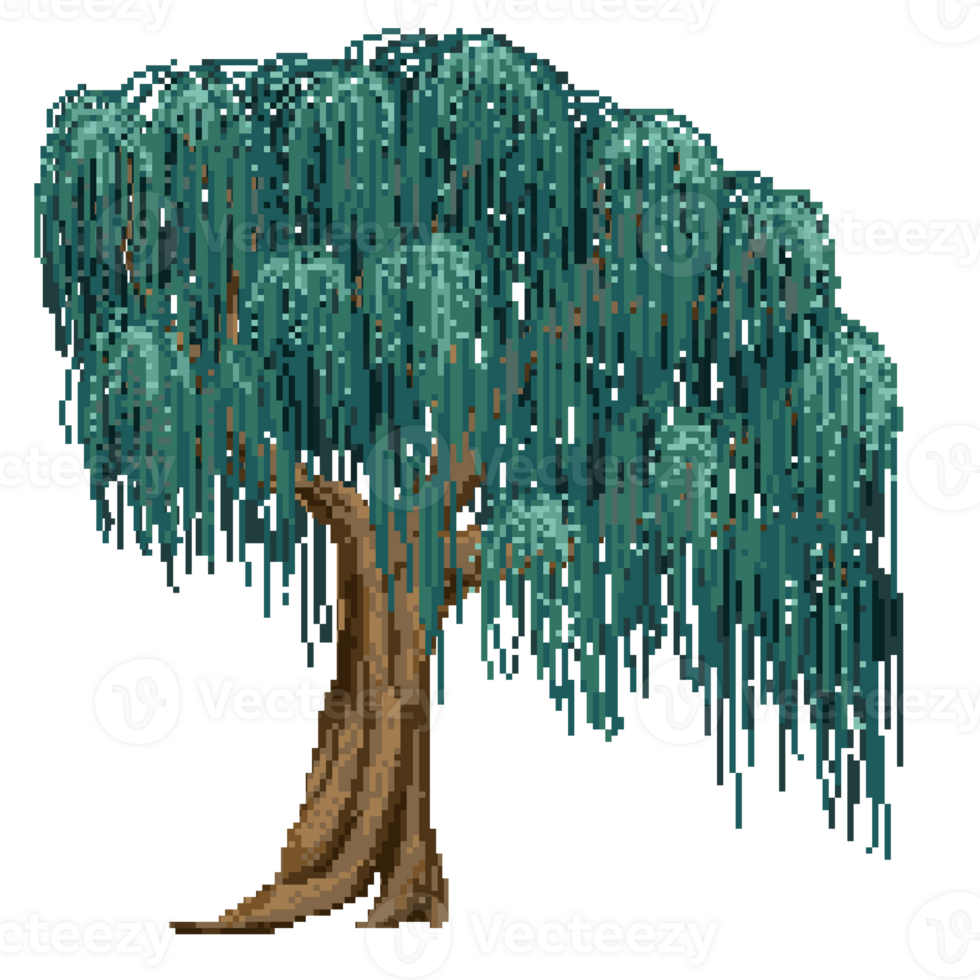

  

  <strong>💙 welcome to my github 💙</strong>

  I'm a Cornell CS & ECE student, interested in building physical AI and intelligent systems to enhance daily life!

Website: [shreyaasanjay-portfolio.vercel.app/](https://shreyaasanjay-portfolio.vercel.app/)
Linkedin: [www.linkedin.com/in/shreyaa-sanjay](https://www.linkedin.com/in/shreyaa-sanjay-3166b2275)
Email: ss4457@cornell.edu

  
  &nbsp;&nbsp;&nbsp;
  
   

<!--This is $\color{blue}{\text{red text}}$ inside a sentence.-->

<!--
**shreyaasanjay/shreyaasanjay** is a ✨ _special_ ✨ repository because its `README.md` (this file) appears on your GitHub profile.

Here are some ideas to get you started:

- 🔭 I’m currently working on ...
- 🌱 I’m currently learning ...
- 👯 I’m looking to collaborate on ...
- 🤔 I’m looking for help with ...
- 💬 Ask me about ...
- 📫 How to reach me: ...
- 😄 Pronouns: ...
- ⚡ Fun fact: ...
-->
